# Open Source Metro

## New experimental capabilities | Mobile + public-event snapshots

A **dedicated 460 × 808 mobile portrait card** is now available. It deliberately shows the **most recent 16 weeks**, rather than crushing the annual 53-week chart into an unreadable phone width. Its stops and repository routes are based only on observed source events, with a separate midnight and paper theme. [Mobile architecture and examples](docs/MOBILE_PROFILE.md).

```powershell
py -3 -m open_source_metro.mobile_profile --input examples/demo-activity.json --output output/mobile-showcase.svg --showcase
py -3 -m open_source_metro.mobile_profile --input examples/demo-activity.json --output output/mobile-fixture.svg
```


### Portrait mobile gallery (synthetic illustration)

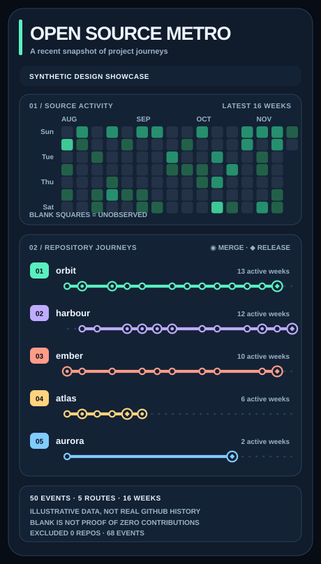

<details>
<summary>Paper theme and original fixture-only mobile version</summary>

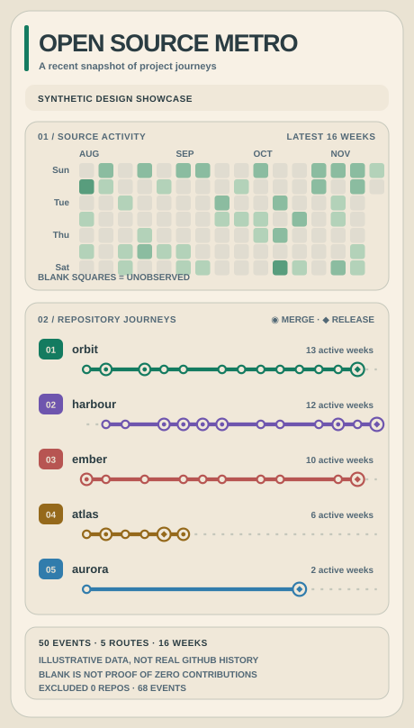

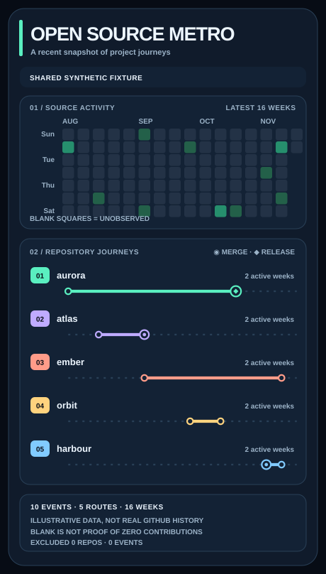

</details>

The initial **public GitHub Events API adapter** supports recent source-backed, username-specific events without a token, but is **not a complete GitHub contribution history**. It accesses only public events, at most 300 events from the previous 30 days, and skips pushes without explicit commit lists rather than inventing counts. All results are written only to local `output/`, never checked in as the owner's activity.

```powershell
py -3 -m open_source_metro.public_events AdityaSreevatsaK --output output/public-snapshot.json --compact-svg output/public-compact.svg --mobile-svg output/public-mobile.svg
```

[Collector data/coverage contract](docs/PUBLIC_EVENTS_COLLECTOR.md). **Neither output has been installed on the owner's live GitHub profile.**

---
## Living Network | Compact GitHub-profile edition

**Project routes tell the story.** Each coloured line is a repository, with stops only at recorded active weeks. Rings indicate merged PRs; diamonds indicate releases. The upper layer retains the familiar 53-week GitHub-style contribution calendar.

**Chronological compact replay, synthetic demonstration only:**

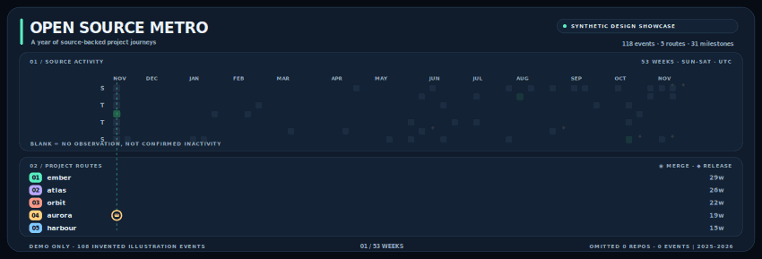

The replay shows train markers at the **latest recorded stop**, never a made-up contribution. The final completed network stays visible for 2.2 seconds. A still-image fallback is available:

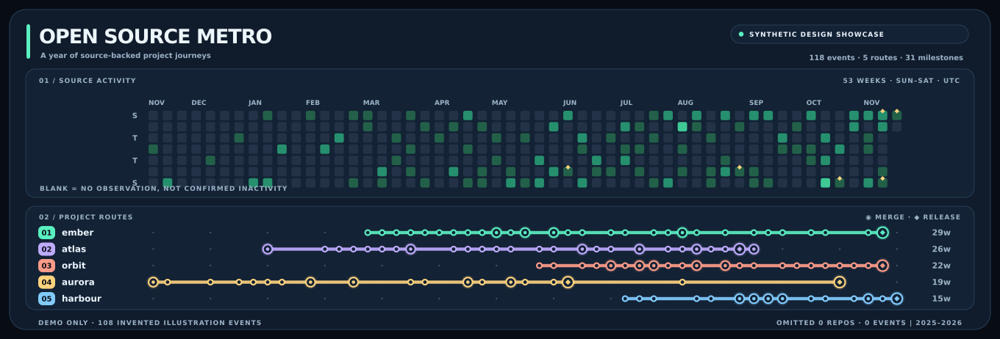

<details>
<summary>Compact alternatives: paper design and faithful ten-event fixture</summary>

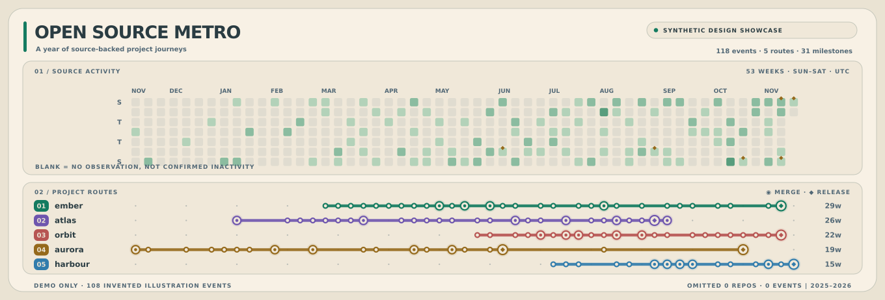

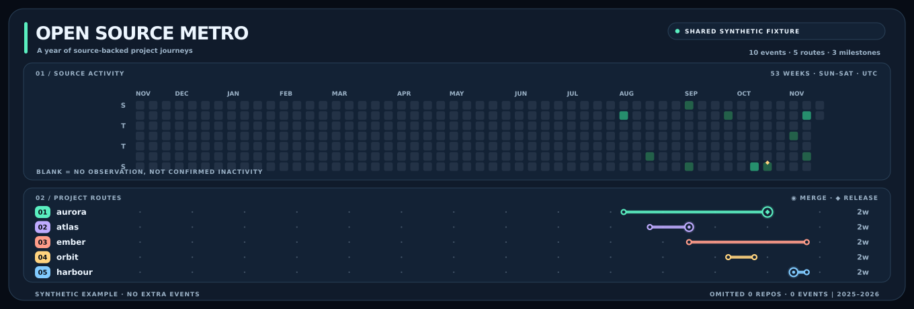

</details>

**The showcase is not your actual GitHub activity.** It includes 108 expressly invented events, while the fixture-only view contains only the original ten example events. These are source-shaped **illustrations**, not GitHub's official contribution totals.

See [compact design specification, generation commands and provenance rules](docs/COMPACT_LIVING_NETWORK.md).

### Full Living Network | Detailed, interactive version

The complete storyboard and its interactive browser event register remain available alongside the compact edition.

<details>
<summary>Watch the original full-size annual replay</summary>

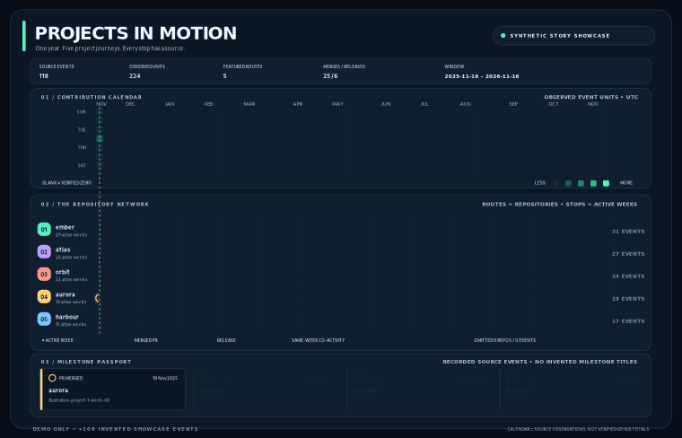

</details>

**The calendar now tells a story instead of just wearing coloured lines.** In this alternative, **each route represents a repository**. Small stops are source-observed active weeks; distinct rings highlight PR merges and releases. A milestone passport shows exact source event IDs and dates. The **interactive replay** lets you travel through 53 weeks, focus on a repository and inspect source events.

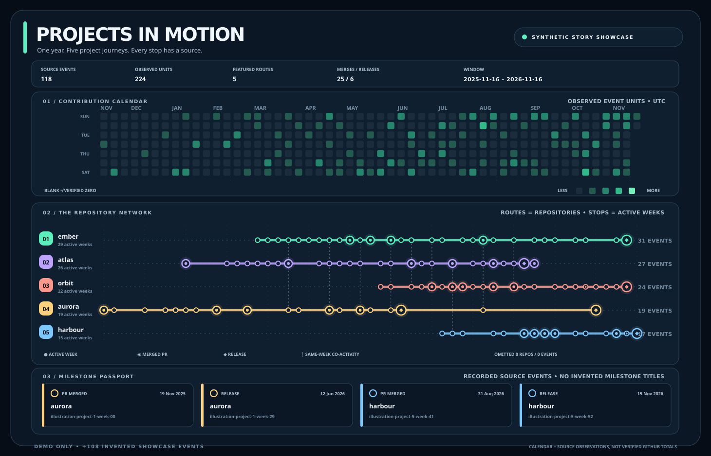

<details>
<summary>Compare paper treatment and faithful sparse fixture</summary>

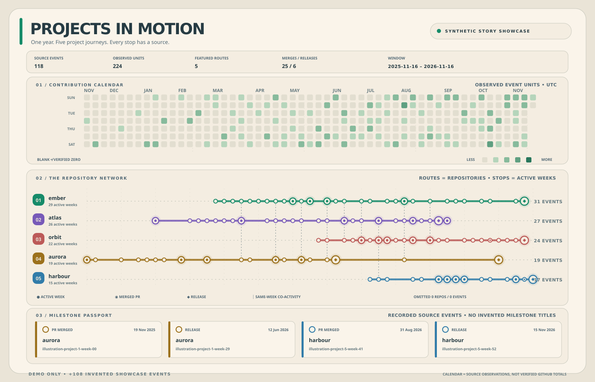

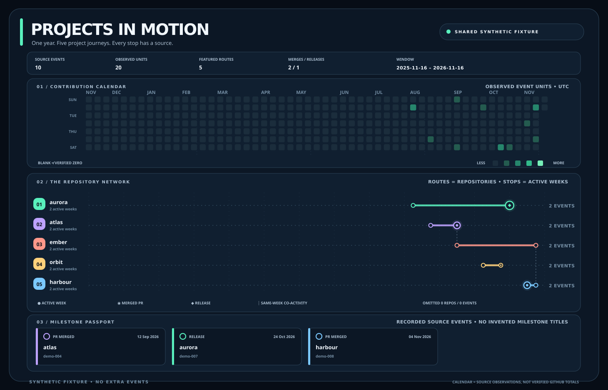

</details>

**These gallery assets are fictional samples, not your real GitHub activity.** The showcase adds 108 clearly marked, deliberately invented event records to the ten-event demo. The fixture version adds none. There is no live GitHub collector.

**Try the working, offline browser replay:**

```powershell
py -3 -m pip install -e .
py -3 -m open_source_metro.living_network --input examples/demo-activity.json --output output/living --showcase
Start-Process .\output\living\living-network-showcase.html
```

Use the Play/Pause controls, week scrubber, speed selector and repo filters to explore observed events. The checked-in [interactive showcase HTML](assets/living-network-showcase.html) can also be downloaded and opened locally. GitHub itself does not run HTML from README embeds.

**Optional GIF export** (not required for the regular Python renderer):

```powershell
py -3 -m pip install -e ".[animation]"
py -3 tools/render_replay_gif.py --input examples/demo-activity.json --output output/living-network-replay.gif --showcase --frames 24 --width 760 --duration-ms 180
```

**Read:** [Living Network design, architecture, semantic rules and limitations](docs/LIVING_NETWORK_EXPERIMENT.md). This is a **separate design experiment on `design/living-network-v1`**, not a replacement for the current production baseline or an approved public release.

---

**A GitHub-style contribution calendar that doubles as a metro map.** Each square represents a date, the five parallel lines represent distinct public-event categories, and numbered terminals identify featured repositories.

> **Project status: experimental / pre-alpha.** This is a reproducible offline visualisation prototype, not an official GitHub contribution graph or a completed public-data collector. The design is still under review.

## Design gallery

### Midnight Metro (explicitly synthetic density showcase)

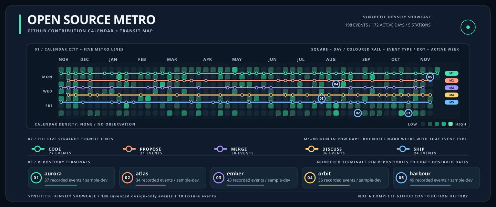

### Parchment Metro (same synthetic showcase)


### Original fixture without added activity


The two showcase previews add **188 deliberately synthetic events** to make the layout easier to evaluate. The fixture-only preview shows **exactly ten** source-example events. **None of these charts represents the repository owner's actual GitHub contributions.**

## Understand the map

| Visual element | Meaning | Important limitation |
| --- | --- | --- |
| 53 × 7 squares | Sunday-to-Saturday calendar aligned to the generated snapshot | Blank squares mean *no event in the supplied snapshot*, not necessarily zero GitHub contributions |
| Green intensity | Source-backed event units on a day | Unlike event types are **not** all commits |
| Five straight lines | CODE: commits; PROPOSE: opened PRs; MERGE: merged PRs; DISCUSS: opened issues; SHIP: releases | Rails are schematic lanes, **not** evidence of journeys between repositories |
| Coloured roundels | Weeks with recorded events in that service | Rails between stops do not imply activity on unmarked dates |
| Numbered terminals | Selected repositories anchored to observed dates | Only five repositories are featured; omissions must be disclosed |

## Quick start on Windows

Requires **Python 3.11+**, Git and no API token. The renderer itself uses the Python standard library.

```powershell
git clone https://github.com/AdityaSreevatsaK/Open-Source-Metro.git
cd Open-Source-Metro
py -3 -m pip install -e .
py -3 -m open_source_metro --input examples/demo-activity.json --output output
py -3 -m unittest discover -s tests -v
```

Use `python` instead of `py -3` on Linux/macOS. Outputs are three deterministic SVGs in `output/`. To try a public, **already normalised** v1 snapshot, supply its JSON path as `--input`. The renderer does **not** fetch GitHub data.

### Repository layout

```text
src/open_source_metro/   Standalone validator and deterministic SVG renderer
examples/                Labelled, synthetic v1 input snapshot
assets/                  Reviewed, reproducible static SVG previews
tests/                   Offline unit, safety, provenance and regression tests
docs/                    Architecture, data contract, design and release guidance
.github/workflows/       Token-free CI on Windows and Linux
AGENTS.md                Required reading and working agreement for AI agents
CONTRIBUTING.md          Human contributor workflow
SECURITY.md              Responsible disclosure and data-handling expectations
```

## Development, agents and public release

Start with [AGENTS.md](AGENTS.md), then [Architecture](docs/ARCHITECTURE.md), [Data contract](docs/DATA_CONTRACT.md), [Design principles](docs/DESIGN_PRINCIPLES.md), [Development guide](docs/DEVELOPMENT.md), [Agent handover](docs/AGENT_HANDOVER.md), and [Release checklist](docs/RELEASE_CHECKLIST.md).

All work should be reviewed and tested before claiming production readiness. **No real-account data is bundled, no paid API is required and no GitHub profile is modified.** A complete contribution history requires an independently designed, coverage-aware collector; the new public Events API adapter is only a limited 30-day source, not complete GitHub contribution coverage.

### Origin and licensing

Extracted as a standalone project from the Open Source Metro experiment in [GitHub Activity Studio](https://github.com/AdityaSreevatsaK/GitHub-Activity-Studio/tree/concept/open-source-metro). Obsolete alternate renderers and unrelated concepts were intentionally not copied.

MIT licence. No release has been published and the current artwork is a design candidate, not the final visual identity.
