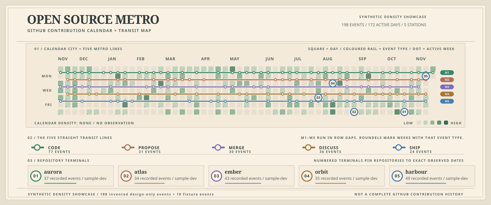
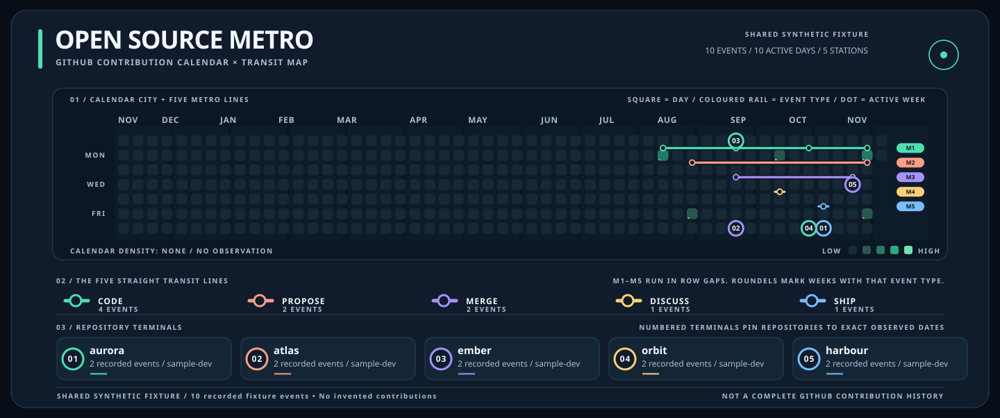

# Open Source Metro

**A GitHub-style contribution calendar that doubles as a metro map.** Each square represents a date, the five parallel lines represent distinct public-event categories, and numbered terminals identify featured repositories.

> **Project status: experimental / pre-alpha.** This is a reproducible offline visualisation prototype, not an official GitHub contribution graph or a completed public-data collector. The design is still under review.

## Design gallery

### Midnight Metro (explicitly synthetic density showcase)


### Parchment Metro (same synthetic showcase)



### Original fixture without added activity



The two showcase previews add **188 deliberately synthetic events** to make the layout easier to evaluate. The fixture-only preview shows **exactly ten** source-example events. **None of these charts represents the repository owner's actual GitHub contributions.**

## Understand the map

| Visual element | Meaning | Important limitation |
| --- | --- | --- |
| 53 × 7 squares | Sunday-to-Saturday calendar aligned to the generated snapshot | Blank squares mean *no event in the supplied snapshot*, not necessarily zero GitHub contributions |
| Green intensity | Source-backed event units on a day | Unlike event types are **not** all commits |
| Five straight lines | CODE: commits; PROPOSE: opened PRs; MERGE: merged PRs; DISCUSS: opened issues; SHIP: releases | Rails are schematic lanes, **not** evidence of journeys between repositories |
| Coloured roundels | Weeks with recorded events in that service | Rails between stops do not imply activity on unmarked dates |
| Numbered terminals | Selected repositories anchored to observed dates | Only five repositories are featured; omissions must be disclosed |

## Quick start on Windows

Requires **Python 3.11+**, Git and no API token. The renderer itself uses the Python standard library.

```powershell
git clone https://github.com/AdityaSreevatsaK/Open-Source-Metro.git
cd Open-Source-Metro
py -3 -m pip install -e .
py -3 -m open_source_metro --input examples/demo-activity.json --output output
py -3 -m unittest discover -s tests -v
```

Use `python` instead of `py -3` on Linux/macOS. Outputs are three deterministic SVGs in `output/`. To try a public, **already normalised** v1 snapshot, supply its JSON path as `--input`. The renderer does **not** fetch GitHub data.

### Repository layout

```text
src/open_source_metro/   Standalone validator and deterministic SVG renderer
examples/                Labelled, synthetic v1 input snapshot
assets/                  Reviewed, reproducible static SVG previews
tests/                   Offline unit, safety, provenance and regression tests
docs/                    Architecture, data contract, design and release guidance
.github/workflows/       Token-free CI on Windows and Linux
AGENTS.md                Required reading and working agreement for AI agents
CONTRIBUTING.md          Human contributor workflow
SECURITY.md              Responsible disclosure and data-handling expectations
```

## Development, agents and public release

Start with [AGENTS.md](AGENTS.md), then [Architecture](docs/ARCHITECTURE.md), [Data contract](docs/DATA_CONTRACT.md), [Design principles](docs/DESIGN_PRINCIPLES.md), [Development guide](docs/DEVELOPMENT.md), [Agent handover](docs/AGENT_HANDOVER.md), and [Release checklist](docs/RELEASE_CHECKLIST.md).

All work should be reviewed and tested before claiming production readiness. **No real-account data is bundled, no paid API is required and no GitHub profile is modified.** A complete contribution history requires an independently designed, coverage-aware collector; no endpoint is presently treated as a source of complete GitHub contribution totals.

### Origin and licensing

Extracted as a standalone project from the Open Source Metro experiment in [GitHub Activity Studio](https://github.com/AdityaSreevatsaK/GitHub-Activity-Studio/tree/concept/open-source-metro). Obsolete alternate renderers and unrelated concepts were intentionally not copied.

MIT licence. No release has been published and the current artwork is a design candidate, not the final visual identity.
